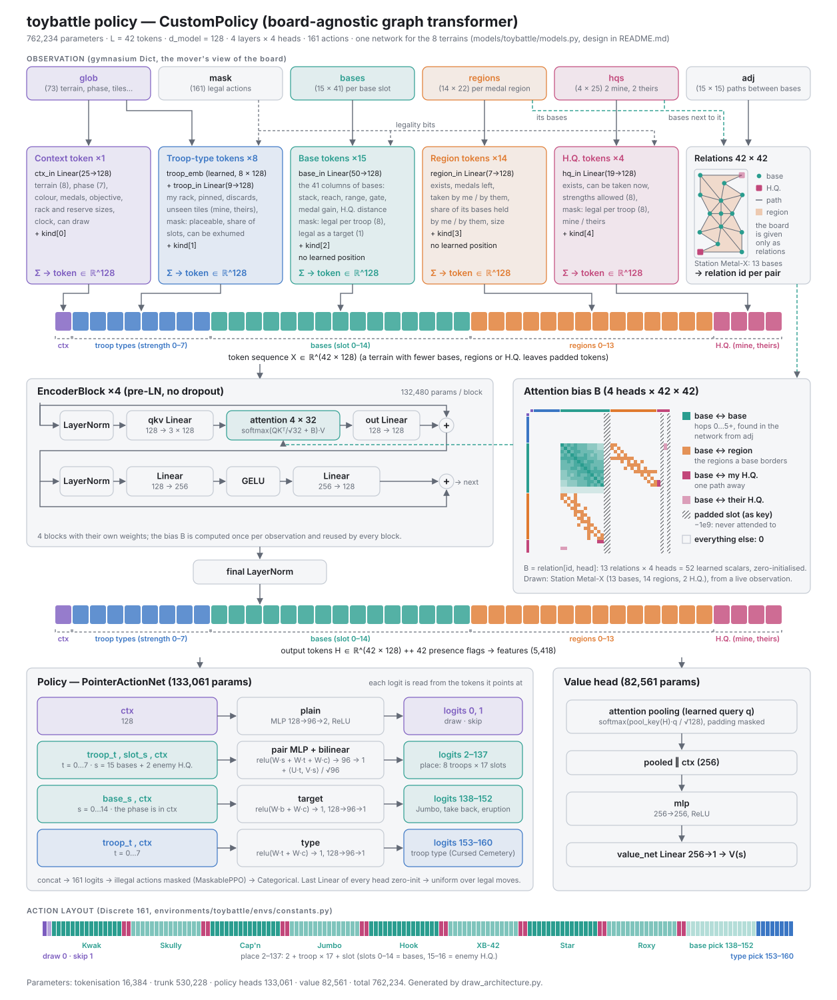

# Toy Battle policy (`models/toybattle/models.py`)

One network for the 8 terrains: a graph transformer that reads the board from the observation
instead of memorising slots, with pointer heads onto the actions. About 762k parameters; one
decision takes a couple of milliseconds on a CPU.



`architecture.svg` and its one-page `architecture.pdf` are generated from the live network (sizes,
parameter counts) and from a live observation of one terrain (the board thumbnail and the relation
matrix of the attention-bias panel): `python3 -m models.toybattle.draw_architecture --pdf` from
`app/` (`--pdf` needs Chrome or Chromium; without it only the SVG is written).

## Why this shape

Measured on 1,600 random games before choosing (learner's point of view):

- The return of a game is exactly +1 / -1. 83% of the steps carry no reward; the medal potential
  pays about 0.12 per event, 0.34 per game. About 24 decisions per game.
- 87% of the decisions are the main draw-or-place choice, 12 legal actions on average (71 at most).
- Slot *i* is a different base on every terrain, so a flat network has to learn 8 boards
  separately; what the game asks for (close a region, cut a connection, cover a weaker troop) is
  the same local pattern on all of them.

So nothing in the network is tied to a board. A base is a token built from its own features — there
is no learned position — and the board comes in only as relations between tokens. Renumbering the
bases of an observation renumbers the logits exactly (`test_model.py`).

## Network

**Tokens (42).** Padded rows are never attended to.

| token | count | built from |
|---|---|---|
| context | 1 | terrain, phase, colour, medals, rack and reserve sizes, clock, can-draw |
| troop type | 8 | a learned type embedding + my rack, pinned, both discards, both unseen counts, and what the mask allows for that type (placeable, share of slots, exhumable) |
| base | 15 | the 41 columns of `bases` + its legality for each troop type and as a target (from `mask`) |
| region | 14 | medals left, taken by me / them, share of its bases each side holds, size |
| H.Q. | 4 | exists, can be captured now, strengths allowed, legality per troop type, mine / theirs |

**Trunk.** 4 pre-LN blocks, width 128, 4 heads, feed-forward 256, no dropout. Each head adds a
learned bias to its attention scores from the relation between the two tokens:

- base – base: hop distance 0..5+ (computed in the network from `adj`),
- base – region it borders (both directions),
- base – my H.Q. / their H.Q. one path away (both directions).

The biases start at zero.

**Policy heads** (`PolicyHeads`), all read the output tokens:

- place troop *t* on slot *s* (bases, then the enemy H.Q.):
  `MLP(relu(W_s slot_s + W_t troop_t + W_c ctx)) + <U troop_t, V slot_s>`;
- pick a base (Jumbo, take back, eruption source and destination): `MLP(base_s, ctx)` — the phase is
  in the context;
- pick a troop type (Cursed Cemetery): `MLP(troop_t, ctx)`;
- draw, skip: `MLP(ctx)`.

Their last layers start at zero, so the untrained policy is uniform over the legal actions.

**Value head.** Attention pooling over the tokens (a learned query) with the context token ->
256 -> 1, on the shared trunk.

**SB3 plumbing** (the pattern of `models/smallw` and `models/jamaica`): `ToyBattleExtractor` is the
trunk and returns `[tokens flattened | presence]`; `ToyBattleLatent` replaces the MlpExtractor
(actor = identity, critic = the value head); `PointerActionNet` replaces the action layer in
`_build`, then the optimizer is rebuilt. `ToyBattleNet` chains the same three parts without SB3.

**Breaking changes.** The network reads the observation through the names of
`environments/toybattle/envs/constants.py` (`B_*`, `G_*`). A change of the observation or action
layout invalidates the saved models: give it a new policy class and registry name.

## Gate 1 — supervised check (`imitation.py`)

Before any PPO run: can the network learn what a simple player knows, and does it carry over to a
board it never saw? The teacher is the one-ply greedy player (`greedy` agent). 2,640 games between
two such players acting at random 30% of the time; 69,104 positions from 7 terrains for training,
Caribbean Sea held out entirely (it has no special base, so only the shape of the board is new).
"Teacher's move" is counted on the decisive positions only — those where some legal actions pay
more than others, about a quarter of them.

| model | medal-gain columns | teacher's move, seen terrains | teacher's move, unseen terrain | winning move found (seen / unseen) | winner predicted (seen / unseen) |
|---|---|---|---|---|---|
| this network, 3 epochs | yes | 99.5% | 99.7% | 97.7% / 99.8% | 64.5% / 66.6% |
| this network, 3 epochs | no | 99.6% | 99.8% | 98.2% / 99.8% | 64.3% / 67.2% |
| flat MLP (1.2M), 12 epochs | yes | 92.5% | 69.5% | 86.8% / 76.1% | 62.0% / 60.7% |
| flat MLP (1.2M), 12 epochs | no | 88.4% | 40.0% | 82.2% / 45.9% | 61.2% / 57.7% |
| chance / medal lead | | 13.7% | 13.4% | | 58.8% / 59.4% |

The network is at 99.5% after one epoch (269 updates) and loses nothing on the unseen terrain; the
MLP does neither. Limits of the check: the teacher looks one move ahead, one seed, one held-out
terrain. The medal-gain columns of the observation make no difference to this network here (they
do to the MLP); they are kept because they are free.

```sh
python3 -m models.toybattle.imitation generate --out /tmp/tb_data --games 330      # ~12 min on 3 cores
python3 -m models.toybattle.imitation train --data /tmp/tb_data --model graph      # ~14 min on a CPU
python3 -m models.toybattle.imitation train --data /tmp/tb_data --model mlp --epochs 12 --no-helpers
```

## Gate 2 — PPO smoke run

From scratch on a 4-core CPU, 17 minutes:

```sh
python3 train.py -r -kl -e toybattle -n_envs 4 -os 512 -ob 256 -oe 4 -g 0.995 -ent 0.01 -lr 3e-4 -t 0.2 -ne 60 -ef 1024 -ts 45000
```

Win rate against the untrained start model at each evaluation (60 games, every 4,096 steps):
63%, 77%, 93%, 90%, 92%, 97%, 100%, 98%, 98%, 100%, 100%; six generations promoted. The last one
(45,056 steps), 200 games on random terrains with `test.py -r`:

| opponent | sampling | best action (`-b`) |
|---|---|---|
| `random` | 100% | 100% |
| `greedy` | 92.5% | 99% |

It wins on every terrain (34 to 40 games out of 40 against `greedy` on each), about three times out
of four by reaching the enemy H.Q. in some 22 turns: neither scripted player defends its H.Q., so
these two yardsticks are passed early and say little after that. From there the signals to watch
are the promotions and head-to-head games between generations.

## Training

```sh
python3 train.py -r -e toybattle -dev cuda -n_envs 8 -os 1024 -ob 1024 -oe 5 -g 0.995 -ent 0.01 -lr 2e-4 -t 0.2 -ne 200
python3 train.py -e toybattle -dev cuda ...                              # continue from best_model.zip
python3 test.py -g 200 -r -a best_model _model_00010_... -e toybattle    # a generation against an older one
```

- `-t 0.2`: a new generation needs 60% of the points against the current opponents (the Schotten
  Totten lesson); with `-ne 200` that is about 3 standard errors.
- `-g 0.995`: a game is about 24 decisions and the reward that matters comes at the end.
- `-n_envs 8` is an estimate for 8 GB: every worker of the self-play wrapper also loads the opponent
  models on the device.
- TensorBoard: `eval/win_rate_vs_base` (against the model the run started from) saturates fast;
  `eval/mean_reward` is the self-play score that drives the promotions, and
  `eval/mean_reward_<terrain>` / `eval/mean_reward_vs_base_<terrain>` split both per terrain
  (`GBEnv.episode_group`).
